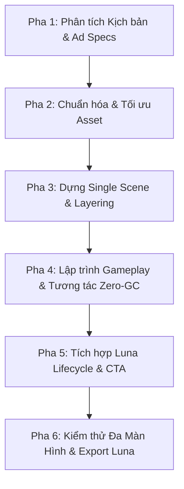

# LUNA PLAYABLE ADS UNIVERSAL DEVELOPMENT WORKFLOW

Skill này cung cấp quy trình 6 bước chuẩn hóa áp dụng cho **bất kỳ thể loại game nào** (Puzzle, Match-3, Runner, Merge, Interactive Story, Idle, Action) khi phát triển hoặc chuyển đổi sang phiên bản Luna Playable Ads.

---

## QUY TRÌNH 6 PHA TIÊU CHUẨN (UNIVERSAL 6-PHASE PIPELINE)



---

### PHA 1: PHÂN TÍCH KỊCH BẢN & YÊU CẦU QUẢNG CÁO (HOOK & AD SPECS)
1. **Gameplay Hook (3 - 5 giây đầu)**:
   - Cơ chế cốt lõi để thu hút người chơi tương tác ngay lập tức (bàn tay chỉ dẫn / prompt trực quan).
2. **Kịch bản Gameplay**:
   - Thao tác chính: Kéo thả (Drag & Drop), Chạm chọn (Tap/Click), hoặc Vuốt (Swipe).
   - Điều kiện hoàn thành (Win Condition) hoặc Thất bại (Lose Condition).
3. **Chiến lược Kêu gọi hành động (Call To Action - CTA)**:
   - Thời điểm xuất hiện: Sau khi hoàn thành mục tiêu, sau N lần tương tác, hoặc sau khi hết thời gian đếm ngược.
4. **Xác định các tham số linh hoạt (Playground Fields)**:
   - Các biến Creative UA có thể muốn A/B testing: thời gian chơi, màu sắc nút CTA, số lần thử.

---

### PHA 2: CHUẨN HÓA & TỐI ƯU HÓA ASSET (ASSET OPTIMIZATION)
> [!IMPORTANT]
> Mục tiêu tối thượng của Playable Ads là dung lượng nén nhỏ (< 2 - 3 MB) và tải nhanh.

1. **Textures / Sprites / 3D Meshes**:
   - Texture Max Size: `1024` hoặc `512` (trừ trường hợp quá chi tiết mới dùng 2048).
   - Tắt **Generate Mip Maps** cho toàn bộ 2D Sprites và UI.
   - Sử dụng Sprite Atlas để giảm Draw Calls trên WebGL.
2. **Shaders & Materials**:
   - Chỉ dùng Shaders gọn nhẹ tương thích WebGL: `UI/Default`, `Sprites/Default`, `Spine/SkeletonLit`, `Mobile/Unlit`.
   - Tránh các Shader tính toán nặng hoặc hiệu ứng phức tạp không được Luna hỗ trợ.
3. **Âm thanh (Audio)**:
   - Bắt buộc bật **Force To Mono** cho toàn bộ SFX, Voice và BGM.
   - Nén định dạng `Vorbis` với Quality `60% - 70%` hoặc `ADPCM`.
   - Load Type: `Decompress On Load` cho SFX ngắn, `Compressed In Memory` cho nhạc nền dài.

---

### PHA 3: THIẾT LẬP SINGLE SCENE & PHÂN TẦNG HIỂN THỊ (SCENE SETUP)
1. **Scene duy nhất**: Sử dụng 1 Scene duy nhất (ví dụ `SampleScene.unity`). Không dùng nhiều Scene chuyển đổi.
2. **Camera Fit**:
   - Camera 2D Orthographic hoặc 3D với góc nhìn cố định.
   - Clear Flags: `Solid Color` (màu nền chủ đạo).
3. **Phân bổ Phân tầng hiển thị (Depth & Sorting Order)**:
   - `0 - 10`: Background / Môi trường xa.
   - `20 - 40`: Nhân vật, chướng ngại vật, đối tượng chính.
   - `50 - 80`: Đối tượng tương tác (Vật phẩm, đường kẻ, hạt hiệu ứng).
   - `100`: Đối tượng đang được người chơi kéo thả (Active Dragging - luôn nằm trên).
   - `110`: Hướng dẫn (Tutorial Hand / Visual Cue).
   - `200+`: UI Canvas, Header, Thanh tiến độ, Nút bấm CTA, Màn hình kết thúc (EndCard).

---

### PHA 4: LẬP TRÌNH GAMEPLAY ZERO-GC (GAMEPLAY & INPUT LOGIC)
1. **Xử lý Input tương thích Touch & Web**:
   - Sử dụng Unity UI Event Interfaces (`IPointerDownHandler`, `IDragHandler`, `IPointerUpHandler`) hoặc Raycast tính toán qua Camera.
   - Quy đổi tọa độ an toàn bằng `RectTransformUtility.ScreenPointToLocalPointInRectangle`.
2. **Triệt tiêu Garbage Collection (Zero-GC)**:
   - Không khởi tạo `new` đối tượng, không gọi `Instantiate()` / `Destroy()` trong vòng lặp game.
   - Cache sẵn `Camera.main`, các `Component`, `WaitForSeconds`.
   - Dùng Object Pooling nếu có hiệu ứng hạt, text bay, hoặc quái sinh ra liên tục.
3. **Xử lý luồng thời gian & chuỗi hành động**:
   - Dùng Coroutine chuẩn (`IEnumerator`). Tuyệt đối không dùng `async/await` hay `UniTask`.

---

### PHA 5: TÍCH HỢP VÒNG ĐỜI LUNA & CTA (LUNA SDK INTEGRATION)
1. **Tạo cầu nối LunaBridge**:
   - Đảm bảo có script quản lý tập trung và bọc bằng `#if LUNA`:
   ```csharp
   public void OnGameStart()
   {
   #if LUNA
       Luna.Unity.LifeCycle.GameStarted();
   #endif
   }

   public void OnGameFinish()
   {
   #if LUNA
       Luna.Unity.LifeCycle.GameEnded();
   #endif
   }

   public void OpenStore()
   {
   #if LUNA
       Luna.Unity.Playable.InstallFullGame();
   #endif
   }
   ```
2. **Khai báo tham số Playground**:
   - Gắn `[LunaPlaygroundField("Tên hiển thị")]` vào các biến `public` kiểu nguyên thủy (`int`, `float`, `bool`, `string`, `Color`).

---

### PHA 6: KIỂM THỬ ĐA TỈ LỆ & EXPORT LUNA (MULTI-RATIO & BUILD VALIDATION)
1. **Kiểm thử tỉ lệ màn hình trong Editor**:
   - Portrait `9:16` (1080x1920) - máy dọc.
   - Landscape `16:9` (1920x1080) - máy ngang.
   - Tablet `4:3` (2048x1536) - iPad / màn hình vuông.
   - Đảm bảo toàn bộ gameplay cốt lõi và nút CTA nằm trong **Safe Area** an toàn.
2. **Kiểm tra trên Luna Browser / Playground**:
   - Mở cửa sổ Luna Plugin > Run in Browser.
   - Bật F12 Console: Đảm bảo không có Exception đỏ nào xuất hiện trong suốt quá trình chơi.
   - Kiểm tra âm thanh: Xác nhận âm thanh mở khóa mượt mà sau cái chạm đầu tiên (First Interaction).
   - Kiểm tra dung lượng file nén: Đảm bảo nằm trong ngân sách (< 3 MB).
